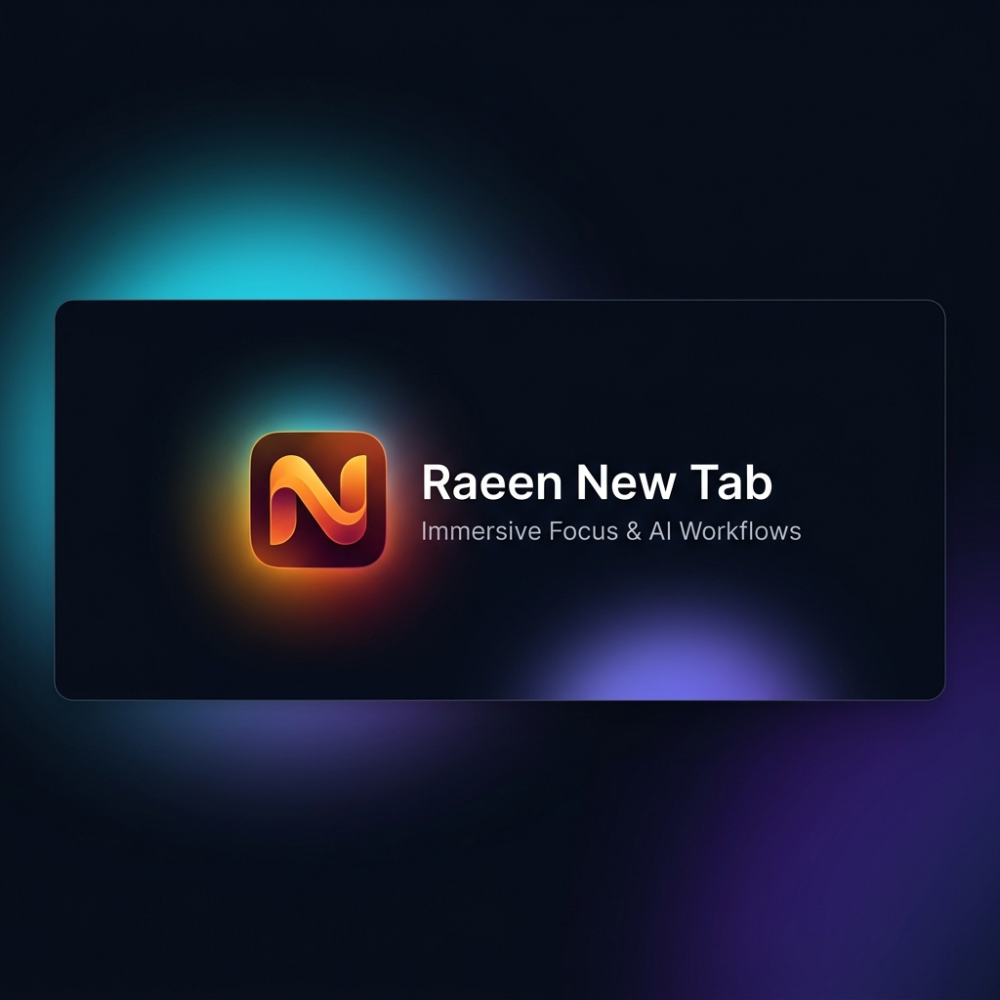
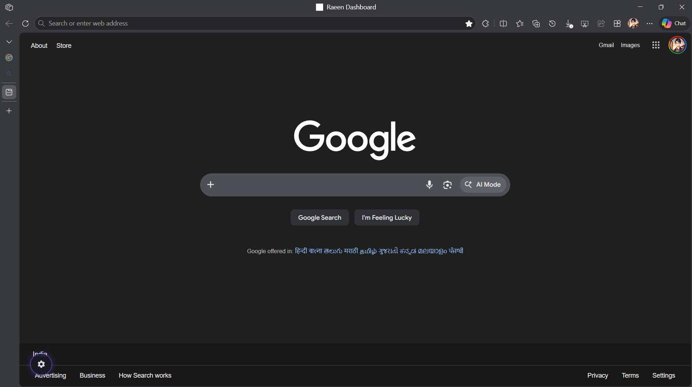
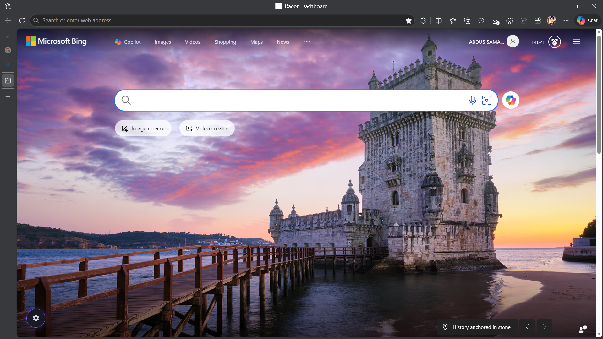
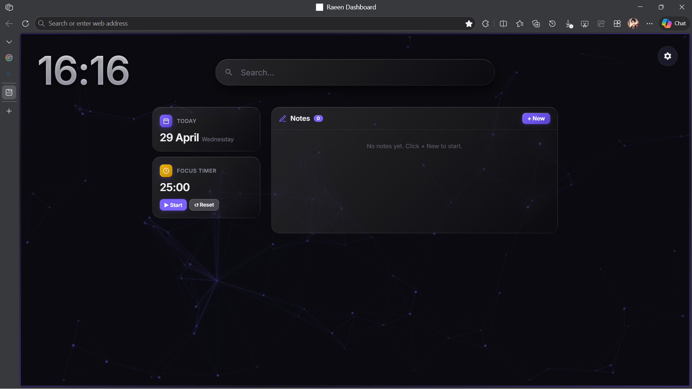
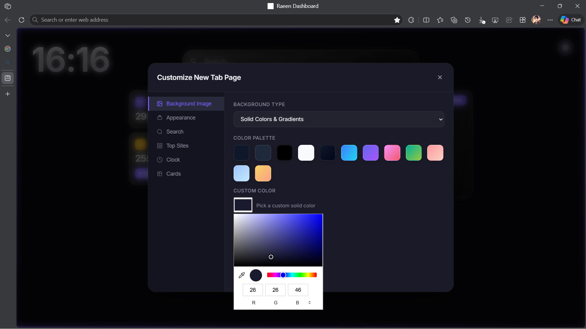

# Raeen Workspace Pro v2.2.0

<p align="center">
  
</p>

<p align="center">
  
  
  
  
  
  
</p>

**Raeen Workspace Pro** is an ultra-fast, visually stunning, privacy-first new tab workspace engineered for Chrome, Edge, and Chromium browsers. Designed with a futuristic **visionOS Liquid Glass** aesthetic, it combines modular widgets, an in-browser privacy shield, creative studio tools, offline peer-to-peer file sharing, and an agent-native control plane for human users and AI bots alike.

---

## 🌟 Highlights & Key Capabilities

### 🪟 1. VisionOS Liquid Glass Design & Multi-Mode Workspaces
* **Zero-Flash Startup**: Instant synchronous hydration with sub-16ms paint times eliminates white-screen reload flash completely.
* **4 Curated Workspaces**:
  * **Minimalist**: Distraction-free search with dynamic 4K wallpapers and time.
  * **Focus**: Centered Pomodoro timer, ambient soundscapes, and quick notes.
  * **Creative Studio**: PhotoCraft image editing, squircle vector design, and PDF tools.
  * **All-in-One Dashboard**: 3-column balanced modular layout with categorized shortcuts, system meters, and customizable widgets.
* **Dynamic Canvas Backgrounds**: 8 hardware-throttled 60 FPS interactive visualizer canvas styles (Neural Network, Starlight, Matrix, Wave, Galaxy, etc.) that automatically pause when tabs are hidden to save CPU and battery.

### 🛡️ 2. Zero-Setup Privacy Shield & Secure VPN
* **Instant In-Browser Shield**: Works immediately upon fresh extension install with zero external files or setup.
* **Hardware WebRTC Protection**: Completely seals local IP address leaks through Chrome's native privacy API.
* **Encrypted DNS-over-HTTPS (DoH)**: Hardens network traffic using Cloudflare, Quad9, Google, or Mullvad DNS resolvers.
* **Tor Onion Circuits & Custom Proxies**: Native SOCKS5 routing support for multi-hop anonymity relays (`127.0.0.1:9050`) with automatic stealth failover.
* **Nuclear Privacy Purge**: Single-click SCRAM button to instantly clear browsing cookies, cache, and origin traces.

### 🎨 3. Built-In Creative Studio & PDF Suite
* **PhotoCraft Studio**: Client-side canvas graphics editor with image filters, background removal, drawing tools, and screen capture markup.
* **VectorCraft**: Mathematical superellipse squircle generator for modern UI icon assets.
* **Zero-Inflation PDF Tools**: Pure client-side PDF compressor featuring stream deflate optimization that guarantees files never increase in size.

### 🎵 4. Multi-Tab Ambient Audio Synthesis
* **Zero-Asset Web Audio**: Synthesizes calming rainfall, ocean waves, white noise, and lo-fi cafe binaural soundscapes natively in the browser without loading heavy audio files.
* **Cross-Tab Leader Election**: Uses `BroadcastChannel` to ensure audio plays continuously from a single elected tab, handing off playback seamlessly if a tab closes without audio overlapping.

### 🤖 5. Universal Agent Command Bus (`window.__RAEEN_AGENT_BUS__`)
* **AI & MCP Native**: A typed command bus allowing AI models (Gemini, Claude, GPT), MCP servers, and browser automation to drive the UI cleanly:
  * `workspace:setMode`
  * `security:connectVpn`
  * `notes:create` / `notes:delete`
  * `timer:start` / `timer:pause`
  * `photocraft:setTool`
  * `studio:applyFilter`
* Full command history, undo/redo stack, and JSON recipe export.

---

## 📸 Screenshots & Previews

<p align="center">
  
  
</p>
<p align="center">
  
  
</p>

---

## 📦 Store Packaging & Deployment

Raeen Workspace Pro compiles to clean, store-compliant **Manifest V3** zip packages ready for publishing on web stores.

### 1. Build Production Zip Package
Run the automated packaging script:

```bash
pnpm zip
```

This compiles optimized bundles with code-splitting and generates:
```
.output/smart-dashboard-2.2.0-chrome.zip  (~21 MB)
```

### 2. Publishing to Google Chrome Web Store
1. Open the [Chrome Developer Dashboard](https://chrome.google.com/webstore/devconsole).
2. Click **Add new item**.
3. Upload `.output/smart-dashboard-2.2.0-chrome.zip`.
4. Fill in listing details:
   * **Name**: Workspace – Smart New Tab
   * **Description**: A premium, minimalist new tab dashboard with integrated AI workflows, focus timer, and privacy shield.
   * **Category**: Productivity.
5. Upload promotional screenshots from `legacy-v1-vanilla/screenshots/` and icons from `public/icon/`.
6. Submit for review!

### 3. Publishing to Microsoft Edge Add-ons
1. Open the [Microsoft Partner Center](https://partner.microsoft.com/dashboard/microsoftedge/overview).
2. Click **Create new extension**.
3. Upload the same `.output/smart-dashboard-2.2.0-chrome.zip` (Edge fully supports Chrome MV3 format).
4. Review permissions and submit!

---

## 🛠️ Local Development & Testing

### Prerequisites
* **Node.js**: v18 or newer
* **pnpm** (recommended) or **npm**

### Installation
```bash
# Clone the repository
git clone https://github.com/abdussamadraeen/Raeen-Dashboard-Pro.git
cd Raeen-Dashboard-Pro

# Install dependencies
pnpm install
```

### Development Server
```bash
# Starts hot-reloading dev environment
pnpm dev
```

### Loading Unpacked in Chrome / Edge
1. Navigate to `chrome://extensions` or `edge://extensions`.
2. Toggle on **Developer mode** in the top right.
3. Click **Load unpacked** and select the `.output/chrome-mv3/` directory.

### Verification Commands
```bash
# Type check all TypeScript code (0 errors)
pnpm compile

# Run complete Vitest integration & unit test suite (72/72 tests passing)
pnpm test

# Build production bundle
pnpm build
```

---

## 🔒 Security & Privacy Architecture

* **No Trackers**: Zero third-party telemetry, no analytics cookies, and no remote code execution.
* **Content Security Policy (CSP)**: Strict `script-src 'self'` with zero `unsafe-eval` or `unsafe-inline`.
* **Multi-Tier Storage**: RAM L1 cache $\to$ IndexedDB L2 $\to$ `chrome.storage.local` L3 fallback with circuit breaker resilience against corruption.
* **XSS Sanitization**: All user-rendered HTML, note text, and search queries pass through comprehensive DOM attribute and protocol sanitizers.

---

## 📄 License

This project is licensed under the **MIT License** - see the [LICENSE](LICENSE) file for details.

---

<p align="center">
  <b>Crafted with excellence by Abdus Samad Raeen</b><br>
  <sub>Raeen Workspace Pro • v2.2.0 Universal Edition</sub>
</p>
